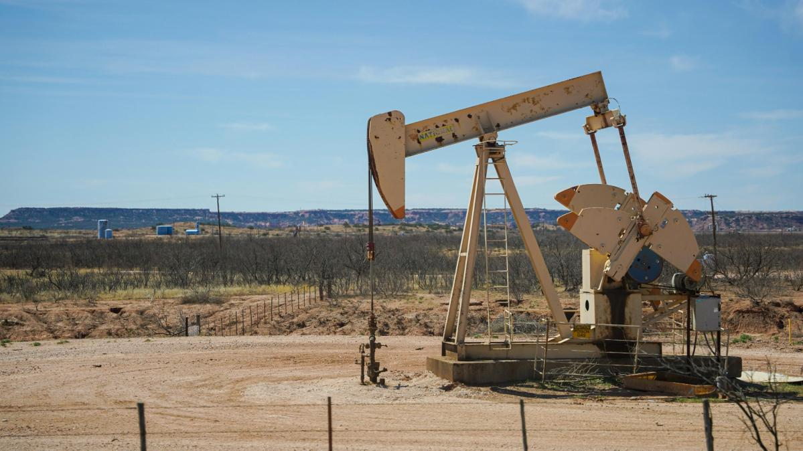
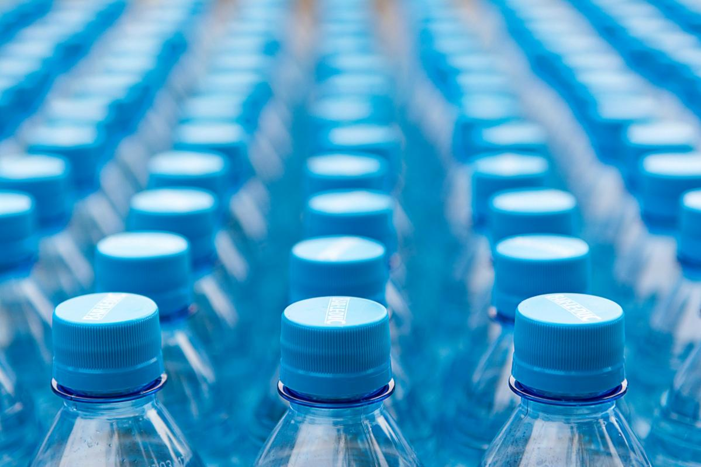

## The transition: an emerging market and a global necessity

The global plastics industry is transforming, shifting from a linear model to a circular model of regeneration. With over 300 million tonnes of plastic produced annually and cumulative waste since 1950 reaching 6.3 billion tonnes, advanced methods like pyrolysis are becoming vital for sustainable management.

This paper analyses the entire cycle: from crude oil extraction and plastic production, through waste generation, and back into valuable feedstock via chemical recycling. Key takeaways include the high liquid yields (71–92 wt% for polyolefins) possible with pyrolysis and the potential for industrially attractive returns. However, critical challenges remain in ensuring standardised product quality, managing variable feedstocks, and demonstrating consistent economic viability at scale. This analysis provides an overview of the technological, market, regulatory, and investment factors shaping the fast-evolving circular plastics economy.

*Keywords: circular economy, plastic waste, pyrolysis oil, chemical recycling, sustainable materials, waste-to-energy*

## Introduction: the imperative for circular plastics

The plastics industry faces a pivotal convergence of environmental necessity and economic opportunity. Production has surpassed 300 million tonnes annually, and projections indicate that waste could reach up to 12 billion tonnes by 2050 if consumption persists. This is unsustainable for the planet and economies. Around 4% of global oil and gas is used for plastic feedstock, with another 3–4% for processing energy.

The circular economy offers a paradigm shift from the traditional ‘take-make-dispose’ approach to one where waste becomes feedstock. Chemical recycling through pyrolysis is especially promising, as it effectively processes contaminated and mixed streams that mechanical recycling cannot handle.

## The forward loop: from crude oil to plastic products

Having established the pressing need for circularity and outlined the potential of advanced recycling, we now turn to the first stage of the plastics lifecycle: how plastic is made from its petroleum origins.

Plastics begin as crude oil extracted using efficient drilling, providing the base for manufacturing large volumes of plastic daily. At the refinery, hydrocarbons are separated by fractional distillation. Naphtha, a C5–C10 blend, is the primary plastic feedstock. Steam cracking at 750–900°C breaks naphtha into ethylene and propylene monomers.

<figure>
  
  <figcaption>Figure 1: Crude oil extraction provides the foundational feedstock for global plastic production. About 4% of total oil and gas output becomes raw plastic material.</figcaption>
</figure>

### Polymerisation and plastic manufacturing

Monomers are polymerised into long-chain plastics. Process conditions define final properties: HDPE is strong and linear, LDPE is flexible and branched, and PP is heat-resistant. Methods like extrusion and moulding turn these into products. Annually, about 100 million tonnes of polyethene and 70 million tonnes of polypropylene are produced.

<figure>
  
  <figcaption>Figure 2: From petroleum to polymers: polyethene and polypropylene products dominate global consumption, shaping daily life across industries.</figcaption>
</figure>

### Product distribution and end-of-life: the big problem

Plastic products serve every imaginable application, from packaging (36%) and construction (16%) to textiles (14%) and electronics (4%). However, their usable life varies wildly: some packaging lasts mere days or months, while automotive parts last 10–15 years, and building materials can endure for over 50 years.

This disparity creates a massive challenge at the end of life. Currently, the system is broken:

- **Mechanical recycling:** Only 9% of plastic is recycled globally, limited strictly to clean, pre-sorted streams.
- **Energy recovery (incineration):** 14% is burned for energy.
- **Landfill disposal:** A massive 36% is simply buried, recovering minimal value.
- **Environmental leakage:** An estimated 22% ends up polluting natural ecosystems.
- **Unmanaged disposal:** 19% is unmanaged in developing regions.

Chemical recycling, primarily through pyrolysis, is positioned to bridge the current gap in plastic waste management. The key takeaway is that this approach can address the limitations of conventional recycling and reduce environmental leakage.

## The reverse loop: chemical recycling through pyrolysis

With the forward journey of plastics complete, attention now shifts to confronting end-of-life challenges. This section focuses on how chemical recycling, particularly pyrolysis, is positioned as a solution to convert waste plastics back into valuable feedstock.

Pyrolysis is the thermal decomposition of plastics without oxygen. Heat at 400–600°C breaks polymers into smaller hydrocarbon molecules, yielding three main products:

1. **Pyrolysis oil (liquid):** The primary product, making up 71–92 wt% for polyolefins.
2. **Syngas (gas):** 8–15 wt%, primarily methane and light hydrocarbons.
3. **Carbon residue (solid):** 5–15 wt%, primarily carbon, though the exact amount depends on the starting material.

Recent advances in catalytic pyrolysis, notably with fluidised-bed reactors, boost liquid yields to 71 wt% and enable selective chemical production.

### Product quality: not your grandfather’s oil

The resulting pyrolysis oil is not identical to traditional petroleum products; its chemical fingerprint is quite different. For example, polypropylene pyrolysis oil shows:

- **Bromine number:** 85–304 (a high value indicating many olefins).
- **Aromatic content:** 15–40% by weight.
- **Cyclic compounds:** 20–35% by weight.
- **Paraffins:** 25–45% by weight.

This profile contrasts sharply with refinery naphtha (which has a bromine number of around ≈1), meaning pyrolysis oil usually requires upgrading or blending before direct use in steam crackers. The key takeaway: while different, pyrolysis oil’s lighter fractions contain valuable aromatics (BTX) and alpha-olefins, opening possibilities for targeted chemical recovery.

### Scaling up: the road to industrialisation

Scaling to an industrial level requires optimising parameters:

- **Temperature control:** Maintaining 450–550°C is essential for the highest liquid yields.
- **Residence time:** Vapours only need 0.5–2.0 seconds in the reactor.
- **Heating rate:** Fast pyrolysis demands rapid heating — over 1000°C/s.
- **Feedstock prep:** Waste plastic needs to be shredded into small 2–10 mm particles.

One successful innovation is liquid-fed fast pyrolysis, where plastic waste is first dissolved into recycled wax before being fed into the reactor. The key finding is that this method can be reliably scaled, as demonstrated by micro-scale experiments and models for plants handling 84,000 tonnes/year.

## Economic analysis and market dynamics

After detailing the technological landscape of chemical recycling, it is crucial to evaluate the financial and market dynamics driving commercial adoption. This section examines economic feasibility and market trends shaping industry decisions.

The ultimate viability of a pyrolysis plant hinges on several factors: the scale of the operation, the cost of the feedstock, the efficiency of energy integration, and the market for the final product. The central takeaway is that economic returns are strongly tied to scale and feedstock prices, making optimisation of these factors decisive for success.

- **Large-scale optimistic scenario (200,000 t/yr PP pyrolysis):** This scale is highly lucrative, promising an annual profit of €37.3 million, an 81% return on investment, and an astonishingly fast payback period of 1.16 years.
- **Medium-scale realistic scenario (1 t/hr catalytic design):** Still very strong, with annual revenue of €15.0 million and production costs of €13.7 million. The total investment is €5.3 million, leading to a solid payback period of 2.4 years.
- **Small-scale challenge scenario (HDPE processing):** Here, the economics are much tighter. Production costs can hit £198.40 per barrel, vastly exceeding the market price of £60 per barrel, suggesting that smaller operations won’t be viable without government subsidies or other financial support.

### The cost of waste: feedstock economics

The feedstock itself is the single largest variable cost, often accounting for 40–60% of total operating expenses. Current market realities include:

- **Waste plastic costs:** These fluctuate wildly, ranging from a fee of −$50 (where the operator is paid to take the waste) to a cost of +$200/tonne, depending on how clean and well-sorted the material is.
- **Sorting and preparation:** This crucial step costs $30–80/tonne for mixed waste streams.
- **Transportation:** Regional collection adds another $20–50/tonne.
- **Quality premiums:** Clean, reliably sorted streams command a significant 50–100% price premium because they lead to higher quality, easier-to-process oil.

### Where the oil goes: product market development

Pyrolysis oil is carving out its market along several different paths:

- **Direct fuel applications:** Used for marine gasoil, industrial heating, and power generation. However, market size is limited by stringent quality standards, and the price is generally 60–80% of conventional fuel oil.
- **Chemical feedstock:** Used as a naphtha substitute after being upgraded. This is the holy grail; the market size is potentially unlimited within the massive petrochemical sector, with price realisation hitting 70–90% of virgin naphtha once processing costs are factored in.
- **Speciality chemicals:** Niche markets like BTX recovery, wax production, and carbon black. These are smaller applications but command premium pricing, often reaching 110–150% of commodity equivalents.

## Technological advances and innovation pathways

### Catalytic innovations: faster, cleaner, better

Modern research intensely focuses on creating robust, cost-effective catalysts that can work reliably in demanding industrial settings:

- **Zeolite-based catalysts:** Used to enhance the production of valuable aromatics specifically.
- **FCC-type catalysts:** Known to improve liquid yields in large fluidised-bed systems.
- **Metal-loaded catalysts:** Help lower the required reaction temperatures and boost final product quality.
- **Hierarchical catalysts:** Designed to improve mass transfer and minimise the formation of coke, which is a significant pain point.

The biggest hurdles here involve stopping catalyst degradation (deactivation), lowering regeneration costs, and successfully scaling these lab discoveries to massive industrial reactors.

### Process integration: the smart plant

Advanced plant designs are now integrating multiple unit operations to create smarter systems and better economics:

- **Heat integration:** Using the gas and char products from pyrolysis to power the process itself.
- **Solvent recovery:** Recycling the solvents and waxes used in the process.
- **Product upgrading:** Adding on-site distillation and chemical treatment to immediately improve product quality.
- **Waste heat recovery:** Generating steam and power from excess heat.

These integrated, smart designs can improve overall energy efficiency by a significant 25–40% compared to simpler, standalone pyrolysis units.

### Digital technologies and automation: Industry 4.0

The digital revolution (Industry 4.0) is rapidly being applied to pyrolysis:

- **Process control:** AI-driven optimisation fine-tunes temperature, residence time, and catalyst regeneration in real-time.
- **Predictive maintenance:** Sensors monitor equipment health to schedule maintenance before a failure occurs.
- **Quality assurance:** Real-time analysis ensures product composition meets specifications immediately.
- **Supply chain management:** Blockchain technology is even being used to track feedstock and product flows, ensuring traceability.

## Regulatory drivers and policy framework

### Global regulatory trends: policy is pushing change

Government and supranational regulatory pressure are the primary factors accelerating the adoption of circular economy principles.

**European Union**

- The Packaging and Packaging Waste Regulation (PPWR) mandates a 30% recycled content target by 2030.
- The Single-Use Plastics Directive restricts disposable items.
- The Waste Framework Directive prioritises prevention and recycling in the waste hierarchy.

**United States**

- Extended Producer Responsibility (EPR) programs are being implemented at the state level.
- Federal funds increasingly support recycling technology investment.
- Public companies face stricter corporate sustainability mandates.

**Asia-Pacific**

- China’s famous National Sword policy has severely restricted waste imports.
- Japan has its own voluntary industry targets for plastic recycling.
- South Korea operates a comprehensive EPR system.

### Carbon pricing and climate policy: the economic incentive

Carbon pricing mechanisms are finally starting to create a necessary economic incentive for circular materials:

- **EU Emissions Trading System (ETS):** Prices are high, averaging €80–90 per tonne of CO₂ in 2024.
- **Carbon Border Adjustment Mechanism (CBAM):** This imposes import tariffs on carbon-intensive products.
- **Corporate carbon accounting:** Companies must now report Scope 3 emissions, which include the environmental impact of their raw materials.

Crucially, life cycle assessments (LCAs) confirm the environmental benefit: pyrolysis can cut GHG emissions by 1.5–2.5 tonnes of CO₂-equivalent per tonne of plastic processed compared to simply burning it.

### Quality standards and certification: building trust

To build a reliable market, clear quality standards are emerging:

- **ISCC PLUS:** The key international sustainability certification for circular materials.
- **ASTM D6866:** Used to measure the biogenic content of recycled plastics.
- **Mass balance certification:** This system tracks the chain-of-custody for recycled feedstocks, ensuring integrity in the supply chain.

## Investment analysis and strategic implications

### Market size and growth: a multi-billion dollar opportunity

The global chemical recycling market is exploding.

- **Current market size:** Already $2.4 billion (2023).
- **Projected growth:** A spectacular 18–25% compound annual growth rate (CAGR) through 2030.

Investment capital is pouring in, totalling $7.2 billion globally in 2023 from venture capital, private equity, and strategic corporate players.

### Value chain investment opportunities

Smart investors are looking at specific points in the value chain:

- **Technology providers:** These companies — who make the equipment, catalysts, and license the processes — benefit from high margins and recurring licensing revenue. Investment should target strong R&D capabilities, patent portfolios, and established industrial partnerships.
- **Plant operators:** These are the capital-intensive facility owners who turn waste into products. Success hinges on feedstock security, long-term off-take agreements, and relentless operational excellence.
- **Feedstock aggregators:** These are the companies that collect, sort, and prepare the waste. They are asset-light, benefit from strong regional collection networks, and require investment in collection infrastructure, advanced sorting technology, and robust quality systems.

### Risk factors and mitigation strategies

Every emerging market has risks, but they can be managed:

| Risk type | Description | Mitigation strategy |
| --- | --- | --- |
| Technology risk | Process reliability, product quality, and difficulties scaling up. | Rely on proven technology licensing, complete thorough pilot plant validation, and secure performance guarantees. |
| Market risk | Product pricing volatility and demand uncertainty. | Secure long-term off-take contracts, diversify product sales, and explore vertical integration. |
| Regulatory risk | Sudden policy changes, permitting delays, and compliance hurdles. | Invest in regulatory expertise, engage proactively with stakeholders, and design facilities flexibly. |
| Feedstock risk | Supply availability, quality variation, and cost volatility. | Secure multiple supply sources, invest in strong preprocessing capabilities, and manage inventory strategically. |

## Future outlook and strategic recommendations

### Technology development priorities

The research community needs to focus its energy on five key areas to unlock the industry’s full potential:

1. **Catalyst development:** Creating industrially tough, cost-effective catalysts with far longer lifespans.
2. **Process integration:** Achieving total heat and mass integration for maximum energy efficiency.
3. **Product upgrading:** Finding cost-effective ways to turn pyrolysis oil into refinery-grade chemical feedstocks.
4. **Feedstock flexibility:** Developing systems that can reliably process mixed, contaminated, and even halogenated (chlorine-containing) plastics.
5. **Automation:** Driving down labour costs through advanced process control and robotics.

### Market development strategies

**For chemical companies**

- Secure long-term contracts for pyrolysis oil supply.
- Investing in the upgrading technology needed for feedstock compatibility.
- Develop product portfolios that highlight and make verified claims about recycled content.
- Partner with waste management firms to achieve vertical integration.

**For waste management companies**

- Invest heavily in state-of-the-art sorting and preprocessing facilities.
- Build resilient regional collection networks for waste plastic.
- Partner with pyrolysis operators for guaranteed, high-value off-take.
- Explore redirecting investment in pyrolysis facilities to capture more value.

**For investors**

- Focus on technologies with a proven, industrial track record.
- Prioritise projects that have both secured feedstock and long-term off-take agreements.
- Consider regional advantages related to waste availability and regulatory support.
- Evaluate management teams based on deep operational experience.

### Policy recommendations

**What governments must do**

- Implement consistent and robust EPR frameworks with clear recycling targets.
- Provide strong investment incentives for chemical recycling infrastructure.
- Develop clear, binding quality standards for recycled materials.
- Support R&D collaboration between industry and academia.

**What the industry must do**

- Establish unified, industry-wide quality standards for pyrolysis products.
- Investing in supply chain transparency and traceability systems.
- Collaborate on technology development and risk-sharing.
- Engage proactively and openly with regulators and environmental groups.

## Conclusion: the inevitable transition to circular plastics

The shift of the plastics industry from a linear model to a truly circular one isn’t just an option; it’s one of the most significant industrial transitions of our lifetime. The evidence is clear: pyrolysis technology works, delivering high liquid yields (71–92%) and proving its economic potential with payback periods as fast as 1.16 years for large-scale operations.

However, we can’t pretend it’s easy. The compositional difference between pyrolysis oil and conventional feedstocks demands costly upgrading. Viability depends heavily on scale, feedstock costs, and the integration of process energy. Furthermore, regulatory frameworks are still catching up, creating a degree of uncertainty for those making long-term investment decisions.

Despite these hurdles, the momentum is undeniable and the transition is inevitable:

- **Environmental imperative:** We are projected to hit 12 billion tonnes of plastic waste by 2050. The linear consumption model is simply not sustainable.
- **Economic opportunity:** The circular plastics market is a $2.4 billion opportunity that’s expanding at 18–25% annually, driven by corporate commitments and regulatory necessity.
- **Technological maturation:** Industrial-scale projects are now proving that technical and economic feasibility is real, with ongoing improvements in yield, quality, and cost-effectiveness.
- **Regulatory momentum:** Global policy is now building mandatory recycled content requirements and EPR systems that fundamentally re-engineer market dynamics.

The ultimate question is not about whether pyrolysis oil will ever match the price of virgin feedstocks, but rather how quickly markets will recognise and price in the strategic value of circular materials. The organisations that move early — whether they are technology providers, plant operators, or strategic investors — will capture a disproportionate share of the value as this circular plastics economy truly matures.

The powerful loop from crude oil to plastic products, through pyrolysis oil, and back again is more than just environmental responsibility; it’s the resilient, sustainable, and economically viable foundation of our future materials system.

## References
{: .references-heading}

1. Kumagai, S., Fujiwara, K., Nishiyama, T., et al. (2025). Cover Feature: Chemical Feedstock Recovery Through Plastic Pyrolysis: Challenges and Perspectives Toward a Circular Economy. *ChemSusChem*, 16(2025). doi:10.1002/cssc 70047
2. Zabaniotou, A., & Vaskalis, I. (2023). Economic Assessment of Polypropylene Waste (PP) Pyrolysis in Circular Economy and Industrial Symbiosis. *Energies*, 16(2), 593. doi:10.3390/en16020593
3. Erkmen, B., Ozdogan, A., Ezdeşir, A., et al. (2023). Can Pyrolysis Oil Be Used as a Feedstock to Close the Gap in the Circular Economy of Polyolefins? *Polymers*, 15(4), 859. doi:10.3390/polym15040859
4. Zabaniotou, A., & Vaskalis, I. (2023). Economic Assessment of Polypropylene Waste (PP) Pyrolysis in Circular Economy and Industrial Symbiosis. *Energies*, 16(2), 593. doi:10.3390/en16020593
5. Park, H., Kim, K., Yu, M., et al. (2023). Economic analysis of the circular economy based on waste plastic pyrolysis oil: a case of the university campus. *Environment, Development and Sustainability*. doi:10.1007/s10668-023-02963-1
6. Erkmen, B., Ozdogan, A., Ezdeşir, A., et al. (2023). Can Pyrolysis Oil Be Used as a Feedstock to Close the Gap in the Circular Economy of Polyolefins? *Polymers*, 15(4), 859. doi:10.3390/polym15040859
7. Kumagai, S., Fujiwara, K., Nishiyama, T., et al. (2025). Chemical Feedstock Recovery through Plastic Pyrolysis: Challenges and Perspectives toward a Circular Economy. *ChemSusChem*. doi:10.1002/. cssc 202500210
8. Geyer, R., Jambeck, J. R., & Law, K. L. (2017). Production, use, and fate of all plastics ever made. *Science Advances*, 3(7), e1700782.
9. Erkmen, B., Ozdogan, A., Ezdeşir, A., et al. (2023). Can Pyrolysis Oil Be Used as a Feedstock to Close the Gap in the Circular Economy of Polyolefins? *Polymers*, 15(4), 859. doi:10.3390/polym15040859
10. Chemical Recycling of Mixed Plastic Waste for the Production of Aromatics and Olefins as Monomers for Circular Polyolefins and Polycarbonate. SABIC TRUCIRCLE™ (Case Study). (2023). doi:10.1002/9783527827992.ch68
11. Lu, Y. (2022). Towards a circular economy: liquid-fed fast pyrolysis of waste polyolefin plastics. *MTU Digital Commons*. doi:10.37099/mtu.dc.etdr/1427
12. Koumpakis, D.-A., Michailidou, A. V., Vlachokostas, C., et al. (2024). Closing the Loop between Plastic Waste Management and Energy Cogeneration: An Innovative Design for a Flexible Pyrolysis Small-Scale Unit. *Recycling*, 9(5), 92. doi:10.3390/recycling9050092
13. Kumagai, S., Fujiwara, K., Nishiyama, T., et al. (2025). Chemical Feedstock Recovery through Plastic Pyrolysis: Challenges and Perspectives toward a Circular Economy. *ChemSusChem*. doi:10.1002/. cssc 202500210
14. Suchocki, T. (2024). Sustainable Energy Application of Pyrolytic Oils from Plastic Waste in Gas Turbine Engines: Performance, Environmental, and Economic Analysis. *Sustainability*, 16(19), 8566. doi:10.3390/su16198566
15. Park, H., Kim, K., Yu, M., et al. (2023). Economic analysis of the circular economy based on waste plastic pyrolysis oil: a case of the university campus. *Environment, Development and Sustainability*. doi:10.1007/s10668-023-02963-1
{: .references}
